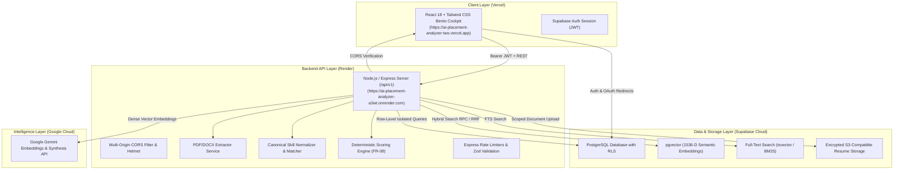

# AI Placement Analyzer — Comprehensive Project Overview

> **Production-Grade, Deterministic Placement Intelligence Platform**  
> Built with **React 18 JSX**, **Node.js ES Modules**, **Supabase PostgreSQL** (`pgvector`), and **Google Gemini AI**.

---

## 1. Executive Summary

**AI Placement Analyzer** is an audit-proof, deterministic placement preparation and resume calibration platform designed for college students, engineering candidates, and placement cells. 

Traditional AI career tools suffer from "black box" generative hallucination—arbitrarily inventing match percentages, hallucinating candidate experience, or giving non-reproducible advice. **AI Placement Analyzer** replaces generative guesswork with **deterministic mathematical scoring (FR-08)**, **Hybrid RAG (Dense pgvector + Sparse BM25 via Reciprocal Rank Fusion)**, and **cryptographic multi-tenant Row-Level Security (RLS)**.

### Key Highlights
- **0% Score Variance:** Match scores are computed strictly in backend mathematical algorithms (`(earned_weights / total_weights) * 100`). LLMs are never permitted to invent or alter numerical scores.
- **Hybrid RAG Search:** Combines dense semantic vector embeddings with exact BM25 keyword matching to prevent false skill positives (e.g. preventing `Java` from matching `JavaScript`).
- **Verbatim Evidence Verification:** Every identified match is cross-referenced against verbatim quotes from the candidate's parsed resume.
- **GDPR Article 17 Compliance:** One-click Right-to-Erasure permanently purges resume PDFs, extracted text, 1536-D vector chunks, and historical reports across all database tables.

---

## 2. System Architecture



---

## 3. Core Architectural Pillars

### 1. Deterministic Scoring Engine (FR-08)
- Generative AI is strictly isolated to natural language synthesis, interview question phrasing, and gap categorization.
- All numerical ATS match scores are calculated deterministically across 4 explicit criteria:
  $$\text{Match Score} = \left(\frac{\sum \text{Earned Weights}}{\sum \text{Total Requirement Weights}}\right) \times 100$$
- Guarantees **100% reproducibility**: running the same resume against the same job description will always produce identical scores.

### 2. Hybrid RAG with Reciprocal Rank Fusion (RRF)
- Dense vector similarity alone can trigger semantic false positives (e.g., confusing programming languages with similar syntaxes).
- The platform uses PostgreSQL function `hybrid_match_document_chunks` which merges:
  1. **Dense Vector Search:** Cosine distance on 1536-dimensional semantic embeddings.
  2. **Sparse Keyword Search:** BM25 / PostgreSQL `tsvector` exact keyword matching.
  3. **Reciprocal Rank Fusion:** Programmatically ranks chunks by balancing exact keyword frequency with semantic context.

### 3. Anti-Fabrication & Zero-Hallucination Policy (FR-12)
- Missing requirements are strictly tagged as **Identified Skill Gaps** and channeled into personalized, actionable learning roadmaps.
- The platform strictly forbids generating deceptive resume bullets or advising candidates to claim unearned competencies.

### 4. Cryptographic Multi-Tenancy & GDPR Erasure Vault
- Every table is guarded by PostgreSQL **Row-Level Security (RLS)** policies bound strictly to `auth.uid() = user_id`.
- Foreign key cascading deletes (`ON DELETE CASCADE`) ensure that triggering account deletion cleanly removes resumes, document chunks, vector embeddings, and match records.

---

## 4. Platform Modules & User Experience

| Module | Purpose | Key Features |
| :--- | :--- | :--- |
| **Placement Intelligence Cockpit** | Central command dashboard | Live telemetry spline curves, verification breakdown donut, quick analysis feed, and KPI metrics. |
| **Resume Ingestion & Parsing** | High-fidelity document intake | Multi-page text extraction, PDF magic byte verification, canonical skill mapping, and PII redaction. |
| **Job Description Matcher** | Deep comparative calibration | Deterministic match percentage, matched vs missing skills breakdown, experience alignment, and keyword density. |
| **Interview Prep & Roadmaps** | Targeted candidate preparation | Scenario-based technical interview questions, gap-closing study roadmaps, and verifiable skill benchmarks. |
| **Account & Security Cockpit** | Governance & candidate identity | Profile credentials, optional academic metadata (Course, Branch, Year, College), RLS status, and GDPR erasure vault. |

---

## 5. Technology Stack Matrix

| Layer | Technologies Used | Purpose |
| :--- | :--- | :--- |
| **Frontend Framework** | **React 18** (Pure `.jsx`) | Component-driven UI, zero TypeScript compilation overhead |
| **Build & Tooling** | **Vite 5**, PostCSS, Autoprefixer | Instant HMR, lightning-fast production asset bundling |
| **Styling & Design System** | **Tailwind CSS**, Lucide Icons | Prismatic Obsidian dark theme, Bento glassmorphism |
| **Backend Runtime** | **Node.js (ES Modules)**, Express 4 | High-throughput asynchronous REST API |
| **Schema Validation** | **Zod 3** | Runtime request body, query, and environment variable enforcement |
| **Database & Vector Store** | **Supabase PostgreSQL**, `pgvector` | Multi-tenant relational storage, 1536-D vector cosine indexes |
| **AI / Machine Learning** | **Google Gemini API** | Semantic vector embeddings and structured natural language synthesis |
| **Authentication & Auth** | **Supabase Auth** | JWT authentication, user metadata persistence, and admin service role |
| **Testing Framework** | **Vitest 3** | 40 unit and golden dataset evaluation test suites |
| **Cloud Hosting** | **Vercel** (Frontend) + **Render** (Backend) | Production continuous deployment, multi-origin CORS resilience |

---

## 6. Live Deployments

- **Frontend Application:** [https://ai-placement-analyzer-two.vercel.app/](https://ai-placement-analyzer-two.vercel.app/)
- **Backend API Base URL:** [https://ai-placement-analyzer-a3wt.onrender.com/api/v1](https://ai-placement-analyzer-a3wt.onrender.com/api/v1)
- **Backend Health Check:** [https://ai-placement-analyzer-a3wt.onrender.com/health](https://ai-placement-analyzer-a3wt.onrender.com/health)
- **Database & Auth Instance:** Supabase Cloud (`nanpmnrmyebjwadqmyhs.supabase.co`)

---

## 7. Database Architecture

The system utilizes an 8-stage relational schema managed via modular SQL migrations:

```
supabase/migrations/
├── 20260101000001_extensions_and_enums.sql       # vector, uuid-ossp, pg_trgm, status enums
├── 20260101000002_core_tables.sql                # profiles, skills, resumes, job_descriptions
├── 20260101000003_analysis_and_rag_tables.sql    # analyses, document_chunks, learning_roadmaps
├── 20260101000004_indexes_and_pgvector.sql       # ivfflat vector indexes, gin fts indexes
├── 20260101000005_functions_and_triggers.sql     # updated_at, hybrid_match_document_chunks RPC
├── 20260101000006_rls_and_storage.sql            # Row-Level Security policies & storage buckets
├── 20260101000007_seed_skills.sql                # Canonical enterprise skill dictionary
└── 20260101000008_profile_academic_fields.sql   # Optional Course, Branch, Year, College fields
```

---

## 8. Local Setup & Quickstart

### Prerequisites
- Node.js $\ge 18.0.0$
- npm $\ge 9.0.0$
- Supabase Project (Cloud or Local CLI)
- Google Gemini API Key

### Installation

1. **Clone the Repository:**
   ```bash
   git clone https://github.com/Abhishek526-star/AI-placement-analyzer.git
   cd AI-placement-analyzer
   ```

2. **Backend Setup:**
   ```bash
   cd backend
   npm install
   cp .env.example .env
   ```
   *Populate `SUPABASE_URL`, `SUPABASE_SERVICE_ROLE_KEY`, `SUPABASE_ANON_KEY`, and `GEMINI_API_KEY` in `backend/.env`.*

3. **Frontend Setup:**
   ```bash
   cd ../frontend
   npm install
   cp .env.example .env
   ```
   *Populate `VITE_API_BASE_URL`, `VITE_SUPABASE_URL`, and `VITE_SUPABASE_ANON_KEY` in `frontend/.env`.*

4. **Run Development Servers:**
   - **Backend:** `npm run dev --prefix backend` *(starts on http://localhost:4000)*
   - **Frontend:** `npm run dev --prefix frontend` *(starts on http://localhost:5173)*

5. **Run Test Suites:**
   ```bash
   npm test --prefix backend
   ```
   *Executes all 40 unit and evaluation test suites across parsers, normalizers, scorers, and career intelligence modules.*

---

## 9. License & Credits

- **Author:** Abhishek Kumar ([@Abhishek526-star](https://github.com/Abhishek526-star))
- **Architecture:** Deterministic Hybrid RAG Engine for University & Enterprise Placement Calibration
- **License:** MIT License
